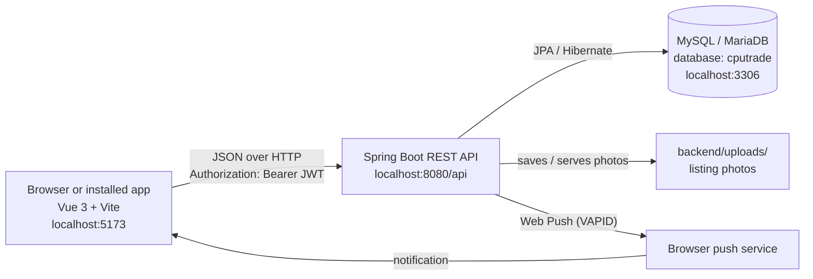
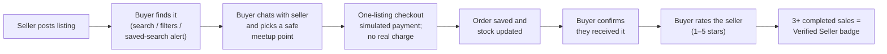
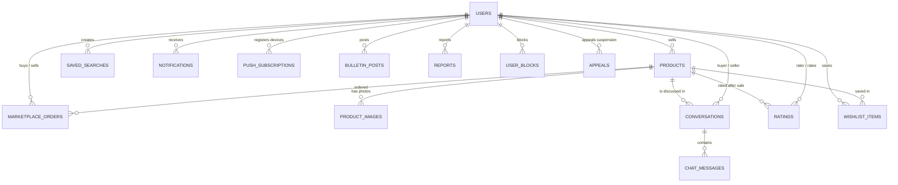

# CPUTrade

**The trusted student marketplace for Cape Peninsula University of Technology (CPUT).**
Buy, sell, swap and give away textbooks, electronics, clothing and services with
fellow students — safely, and on campus.

- **Backend:** Spring Boot 4 (Java 21), Spring Security + JWT, Spring Data JPA / Hibernate, MySQL
- **Frontend:** Vue 3, Vite, Vue Router, Pinia, Axios, installable PWA with Web Push

---

## Contents

1. [What is CPUTrade?](#1-what-is-cputrade)
2. [Features](#2-features)
3. [How it works](#3-how-it-works)
4. [Project structure](#4-project-structure)
5. [Run it locally — overview](#5-run-it-locally--overview)
6. [Step 0 — Install the prerequisites](#6-step-0--install-the-prerequisites)
7. [Step 1 — Create the database](#7-step-1--create-the-database)
8. [Step 2 — Start the backend](#8-step-2--start-the-backend)
9. [Step 3 — Add the admin account (and optional demo data)](#9-step-3--add-the-admin-account-and-optional-demo-data)
10. [Step 4 — Start the frontend](#10-step-4--start-the-frontend)
11. [Step 5 — Log in and try it out](#11-step-5--log-in-and-try-it-out)
12. [Configuration](#12-configuration)
13. [Useful database queries](#13-useful-database-queries)
14. [API reference](#14-api-reference)
15. [Troubleshooting](#15-troubleshooting)
16. [Known limitations](#16-known-limitations)
17. [Project background](#17-project-background)

---

## 1. What is CPUTrade?

### The problem

Students constantly need things other students already have and no longer
use: last year's textbooks, a scientific calculator, a laptop charger, a lab
coat. Today that trade happens in scattered WhatsApp groups and general
classifieds sites, which means:

- **No trust.** Anyone can post, including scammers who aren't students at all,
  and there is no history of whether a seller is reliable.
- **No safety.** Buyers and sellers swap phone numbers with strangers and
  arrange to meet at unfamiliar places.
- **Nothing is organised.** Listings get buried in chat, can't be searched or
  filtered by campus, and nobody knows when an item has already been sold.
- **Waste.** Perfectly good books and equipment get thrown away because there
  is no easy way to give them to someone who needs them.

### The solution

CPUTrade is a marketplace **only for the CPUT community**:

- **Students must register with an official CPUT email** (`@mycput.ac.za` or
  `@cput.ac.za`), so everyone you trade with is a fellow student.
- **Outside businesses (vendors)** can join, but only after an **admin approves
  them**.
- **You chat inside the app**, not by handing out your phone number, and the
  chat suggests **safe on-campus meeting points** (library, IT building, SRC
  office, main gate).
- **Sellers build a reputation.** Buyers can rate a seller only after
  **confirming they actually received the item**. Sellers with 3 or more
  completed sales earn a **Verified Seller** badge.
- **Admins moderate the platform.** They handle reports, remove bad listings,
  suspend accounts and review appeals.
- **It works like an app on a phone.** You can install it to your home screen,
  get push notifications, and browse the last loaded listings while offline.

---

## 2. Features

### For everyone (no login needed)

- Browse the marketplace with **category pills** (Textbooks, Electronics,
  Clothing, Services, Other), **keyword search**, **price range** and a
  **multi-campus filter** (Bellville, District Six, Granger Bay, Mowbray,
  Wellington).
- View listing details: multiple photos, condition, quantity, view count,
  how many people are watching it, and the seller's rating and badges.
- A live **"recently sold" ticker** on the marketplace.
- The **campus bulletin board**, with a structured **Lost & Found** section.
- Share a listing straight to **WhatsApp**.

### For students and sellers (logged in)

| Area | What you can do |
|---|---|
| **Listings** | Create, edit and delete listings with up to **6 photos** (JPEG/PNG, max 4 MB each), a quantity, condition and campus. Price `0` shows a **Freecycle** (free) badge. |
| **Swap / barter** | Mark a listing **"open to swap"** and say what you'd swap it for. |
| **Mark as sold** | Choose which interested buyer bought it. The listing stays up while quantity remains. |
| **Orders and checkout** | Place an order for one listing at a time. Local checkout records a simulated payment only: it does not charge money or collect card details. Stock is updated transactionally, and buyers and sellers can view order history. Sellers can mark an order ready for hand-off; buyers can cancel before confirming receipt, which restores stock. |
| **Buyer confirmation** | The buyer confirms receipt from order history (or the sale flow), which unlocks rating the seller. |
| **Chat** | Private conversation per listing with read receipts, typing indicator, online/last-seen status, edit/delete messages, and safe meetup-location suggestions. |
| **Wishlist** | Save listings and get alerts when the **price drops** or the item is **sold**. |
| **Saved searches** | "Notify me about listings like this" by keyword, category and max price. |
| **Notifications** | In-app notification centre, plus real **Web Push** notifications to your device. |
| **Seller dashboard** | Your listings, total views, sales, average rating, unread chats and messages from buyers. |
| **Safety** | **Report** a user or listing (scam, inappropriate, spam, harassment, other) and **block** users. |
| **Profiles** | Public seller profile with rating, completed sales and Verified Seller badge. |
| **Account privacy** | Delete your account after confirming your password. Private account data and active listings are removed, and your identity is anonymized. Sale and moderation history is retained indefinitely for this school-project prototype; review this policy before real-world use. |

### For vendors (outside businesses)

- Register as a **VENDOR** with any email address.
- Until an admin approves the account, a vendor can **browse but can't create
  or change anything**. Approval sends a notification.

### For admins

| Area | What you can do |
|---|---|
| **Vendor requests** | Approve pending vendor accounts. |
| **Listing moderation** | Remove (deactivate) listings that break the rules. The seller is notified. |
| **Reports queue** | Review or dismiss reports about users and listings. |
| **User management** | Suspend accounts (with a reason, for a set time or indefinitely) and reactivate them. Suspension takes effect **immediately**, even for users who are already logged in. |
| **Appeals** | Suspended users can submit an appeal; admins approve or reject it. |
| **Admin action history** | View the 100 most recent vendor, listing, report, account, and appeal decisions with actor and target snapshots. |

### Platform

- **Installable PWA** (Android, iOS, Windows, macOS) with an offline cache for
  the marketplace feed and the last viewed listing.
- **Mobile-first**, responsive down to 320 px wide screens.
- Passwords hashed with **bcrypt**. Sessions use **JWT** tokens that expire
  after 24 hours.
- Every timestamp uses **South African time** (`Africa/Johannesburg`).

---

## 3. How it works

### Architecture



- The **frontend** is a single-page app. It talks to the backend only through
  the REST API at `VITE_API_BASE_URL` (default `http://localhost:8080/api`).
- On login, the backend returns a **JWT token**. The frontend stores it and
  sends it as `Authorization: Bearer <token>` on every request.
- The **backend** checks the token, the user's role (`STUDENT`, `VENDOR`,
  `ADMIN`) and account status (active, suspended, vendor pending) on every
  request.
- **Database tables are created automatically.** When the backend starts,
  Hibernate creates or updates every table from the Java entity classes
  (`spring.jpa.hibernate.ddl-auto=update`). You only create the empty database.
- **Photos are stored as files** in `backend/uploads/products/`. The database
  only stores each photo's URL (in the `product_images` table).
- **Emails are not really sent yet.** Verification and notification emails are
  written to the backend log instead (see [Known limitations](#16-known-limitations)).

### The life of a trade



For an in-person sale arranged outside checkout, sellers can still record a
sale for an interested buyer and use the same receipt-confirmation and rating
flow.

### Database tables

You never create these by hand. Hibernate creates them when the backend starts.



| Table | What it holds |
|---|---|
| `users` | Every account: username, email, bcrypt password hash, role, vendor approval, suspension status, last active time. |
| `products` | Listings: title, description, price, category, `item_condition`, campus, quantity, swap settings, sold/buyer-confirmed state, view count. |
| `product_images` | Photo URLs for each listing, in display order (`sort_order`). |
| `marketplace_orders` | One-listing orders, buyer/seller, title and price snapshots, quantity, simulated payment status, and receipt timestamps. |
| `admin_actions` | Application-level append-only history of moderation and account decisions, retaining actor and target snapshots without foreign keys. |
| `conversations` / `chat_messages` | One conversation per buyer per listing, and its messages (with read/delivered/edited/deleted state). |
| `ratings` | 1–5 star ratings a buyer gives a seller for a specific purchase. |
| `wishlist_items` | Listings a user has saved. |
| `saved_searches` | Search alerts (keyword, category, max price). |
| `notifications` | In-app notifications. |
| `push_subscriptions` | Devices registered for Web Push. |
| `bulletin_posts` | Bulletin board / Lost & Found posts. |
| `reports` | User and listing reports for admins. |
| `user_blocks` | Who has blocked whom. |
| `appeals` | Suspension appeals. |

---

## 4. Project structure

```
CPUTrade/
├── README.md                  ← you are here
├── DEPLOYMENT.md              ← hosting it anywhere other than your own PC
├── backend/                   ← Spring Boot API (open this folder in IntelliJ)
│   ├── db/
│   │   ├── setup.sql              creates the database + app user (run once)
│   │   ├── seed-admin.sql         creates the admin account
│   │   ├── seed-sample-data.sql   optional demo users, listings and posts
│   │   └── cleanup-test-listings.sql  removes old automated-test listings
│   ├── mvnw, mvnw.cmd         ← Maven wrapper (no Maven install needed)
│   ├── pom.xml
│   ├── uploads/               ← listing photos saved here (created automatically, not in Git)
│   └── src/main/
│       ├── resources/application.properties   ← DB, JWT, CORS, push settings
│       └── java/za/ac/cput/cputrade/
│           ├── CpuTradeBackendApplication.java   ← main class (run this)
│           ├── admin/          vendor approval, moderation, user management
│           ├── bulletin/       bulletin board / Lost & Found
│           ├── chat/           conversations, messages, typing indicator
│           ├── common/         errors, image validation
│           ├── config/         security (CORS, route rules), static /uploads
│           ├── notification/   in-app notifications
│           ├── product/        listings, photos, wishlist, saved searches
│           ├── profile/        public profiles, online presence
│           ├── push/           Web Push subscriptions and sending
│           ├── rating/         seller ratings
│           ├── security/       JWT filter, account-status filter
│           ├── storage/        saving photos to disk
│           ├── trust/          reports, blocks, appeals
│           └── user/           users, registration, login
└── frontend/                  ← Vue 3 app (open this folder in VS Code)
    ├── .env.development       ← VITE_API_BASE_URL for local dev
    ├── vite.config.js         ← Vite + PWA config
    ├── public/icons/          ← app icons
    └── src/
        ├── api/            one file per backend area (axios calls)
        ├── components/     UI pieces (admin, auth, chat, marketplace, product, ...)
        ├── router/         pages and route guards
        ├── stores/         Pinia state (auth, wishlist, push, toasts)
        ├── styles/         design tokens and global CSS
        ├── views/          one file per page
        └── sw.js           service worker (offline cache + push)
```

---

## 5. Run it locally — overview

You need **three things running at the same time**:

| # | Part | Runs on | Pick one tool |
|---|---|---|---|
| 1 | **Database** (MySQL or MariaDB) | `localhost:3306` | MySQL Workbench, XAMPP/phpMyAdmin, IntelliJ Database tool, or a terminal |
| 2 | **Backend** (Spring Boot) | `http://localhost:8080` | IntelliJ IDEA, VS Code, or a terminal |
| 3 | **Frontend** (Vue) | `http://localhost:5173` | VS Code (or any terminal) |

**Do these steps in this order the first time:**

1. Install the prerequisites (JDK 21, Node.js, a database, Git).
2. **Create the database** by running `backend/db/setup.sql`.
3. **Start the backend once.** It creates all the tables automatically.
4. **Add the admin account** by running `backend/db/seed-admin.sql`, plus
   `seed-sample-data.sql` if you want demo data.
5. **Start the frontend** and open http://localhost:5173.

After the first time, you only need to do this: start the database → start the backend → start the frontend.

> **Common setups:**
> - **IntelliJ for the backend + VS Code for the frontend + MySQL Workbench for the database.** Follow 7A → 8A → 9A → 10.
> - **VS Code only + XAMPP.** Follow 7B → 8B → 9B → 10.
> - **Terminal only.** Follow 7D → 8C → 9D → 10.

---

## 6. Step 0 — Install the prerequisites

| Tool | Version | Check it with | Download |
|---|---|---|---|
| **Git** | any | `git --version` | https://git-scm.com/downloads |
| **JDK** | **21** | `java -version` | https://adoptium.net (Temurin 21) |
| **Node.js** | **20.19+ or 22.12+** (Vite 8 needs this) | `node -v` | https://nodejs.org (LTS) |
| **Database** | MySQL **8.x** *or* MariaDB **10.4+** (XAMPP) | — | [MySQL Installer](https://dev.mysql.com/downloads/installer/) (includes Workbench) or [XAMPP](https://www.apachefriends.org) |
| **IDE** | — | — | [IntelliJ IDEA](https://www.jetbrains.com/idea/) and/or [VS Code](https://code.visualstudio.com) |

You **don't** need to install Maven. The project includes a Maven wrapper
(`mvnw` / `mvnw.cmd`) that downloads the right version automatically.

> **Only run one database server at a time.** MySQL and XAMPP's MariaDB both use
> port **3306**. If both are installed, stop one of them. For MySQL, use Windows
> **Services** → `MySQL84` (or similar) → Stop. For XAMPP, use the Control Panel
> → MySQL → Stop.

### Get the code

```bash
git clone https://github.com/Siphokuhle-222357614/CPUTrade.git
cd CPUTrade
```

---

## 7. Step 1 — Create the database

Do this **once**. It creates an empty database called `cputrade` and a MySQL user
called `cputrade_app` that the backend logs in as.

| Setting | Value |
|---|---|
| Host / port | `localhost` / `3306` |
| Database | `cputrade` |
| App username | `cputrade_app` |
| App password | `ChangeMe_StrongPass!` |

These match the defaults in `backend/src/main/resources/application.properties`.
If you change the password in `setup.sql`, see [Configuration](#12-configuration).

Here is what `backend/db/setup.sql` does:

```sql
CREATE DATABASE IF NOT EXISTS cputrade
  CHARACTER SET utf8mb4
  COLLATE utf8mb4_unicode_ci;

CREATE USER IF NOT EXISTS 'cputrade_app'@'localhost' IDENTIFIED BY 'ChangeMe_StrongPass!';
GRANT ALL PRIVILEGES ON cputrade.* TO 'cputrade_app'@'localhost';
FLUSH PRIVILEGES;
```

Pick **one** of the options below.

### 7A. MySQL Workbench

1. Open **MySQL Workbench** and click your **Local instance** connection
   (user `root`). Enter your root password.
2. **File → Open SQL Script…** → choose `CPUTrade/backend/db/setup.sql`.
3. Click the **lightning bolt** ⚡ ("Execute the selected portion of the script
   or everything") or press **Ctrl+Shift+Enter**.
4. In the **Navigator → Schemas** panel, click the refresh icon. You should see
   `cputrade`.
5. *(Optional)* Check that the app user works. Click **+** next to "MySQL
   Connections", then enter username `cputrade_app`, password
   `ChangeMe_StrongPass!` and default schema `cputrade`. **Test Connection**
   should succeed.

### 7B. XAMPP (MariaDB) + phpMyAdmin

1. Open the **XAMPP Control Panel** and click **Start** next to **MySQL**. You
   don't need Apache unless you want phpMyAdmin.
2. To use phpMyAdmin, also start **Apache**, then open http://localhost/phpmyadmin.
3. Click the **SQL** tab, paste the contents of `backend/db/setup.sql` and
   click **Go**.
4. `cputrade` now appears in the left sidebar.

> XAMPP's `root` user has **no password** by default. When a command below
> says `mysql -u root -p`, just press Enter at the password prompt, or leave
> out the `-p`.

### 7C. IntelliJ IDEA Database tool (IntelliJ **Ultimate** only)

1. Open the **Database** tool window (**View → Tool Windows → Database**).
2. **+ → Data Source → MySQL** (or **MariaDB** if you use XAMPP).
3. Host `localhost`, port `3306`, user `root`, and your root password. Click
   **Download missing driver files** if IntelliJ asks, then **Test Connection**
   → **OK**.
4. Right-click the connection → **SQL Scripts → Run SQL Script…** → choose
   `backend/db/setup.sql`. Alternatively, open a **Query Console**, paste the
   script and press **Ctrl+Enter** with all of it selected.
5. Refresh the data source and `cputrade` appears.

> **VS Code alternative:** extensions such as *SQLTools* (with the MySQL
> driver) or *MySQL* by Weijan Chen let you connect and run the same script
> from inside VS Code.

### 7D. Terminal (`mysql` command line)

First, make sure the `mysql` command works. If it says *"not recognized"*, use
the full path:

| Installed | Full path to `mysql` |
|---|---|
| MySQL 8.4 | `"C:\Program Files\MySQL\MySQL Server 8.4\bin\mysql.exe"` |
| XAMPP | `C:\xampp\mysql\bin\mysql.exe` |

(or add that `bin` folder to your Windows **PATH**.)

Then go into the `db` folder and run the script. Each of these does the same
thing:

**Inside the `mysql>` prompt (works in every terminal):**

```bash
cd backend/db
mysql -u root -p
```

```sql
source setup.sql;
SHOW DATABASES LIKE 'cputrade';
SELECT User, Host FROM mysql.user WHERE User = 'cputrade_app';
exit
```

**One line in PowerShell** (the `<` redirect does *not* work in PowerShell):

```powershell
cd backend\db
Get-Content .\setup.sql | mysql -u root -p
```

**One line in Git Bash, Command Prompt, macOS or Linux:**

```bash
cd backend/db
mysql -u root -p < setup.sql
```

Check that the app user can connect (password `ChangeMe_StrongPass!`):

```bash
mysql -u cputrade_app -p cputrade
```

---

## 8. Step 2 — Start the backend

The main class is `za.ac.cput.cputrade.CpuTradeBackendApplication`. It is
ready when the log ends with:

```
Tomcat started on port 8080 (http) with context path '/'
Started CpuTradeBackendApplication in ... seconds
```

On the **first start**, this creates all 14 tables in `cputrade`.

**These warnings are normal and can be ignored when running locally:**

| Warning | Why it's fine |
|---|---|
| `Using the built-in dev-only JWT secret` | Fine on localhost. Set `JWT_SECRET` before deploying (see `DEPLOYMENT.md`). |
| `HHH000511: The 5.5.5 version for [MySQLDialect] is no longer supported` | You're on XAMPP's MariaDB, which reports itself as "5.5.5". The app still works. |
| `spring.jpa.open-in-view is enabled by default` | Spring Boot's default setting. It doesn't affect anything here. |
| `Global AuthenticationManager configured with an AuthenticationProvider bean` | The login provider is set up on purpose. |

### 8A. IntelliJ IDEA

1. **File → Open…** and select the **`backend`** folder (the one that contains
   `pom.xml`), not the repository root. Choose **Trust Project**.
2. Wait for Maven to finish importing (progress bar at the bottom right).
3. **File → Project Structure → Project → SDK** must be **21**. If it isn't
   listed, click **Add SDK → Download JDK… → version 21**.
4. **Lombok:** IntelliJ includes the Lombok plugin. If it asks
   **"Enable annotation processing?"**, click **Enable**. You can also turn it
   on under **Settings → Build, Execution, Deployment → Compiler → Annotation
   Processors**.
5. Open `src/main/java/za/ac/cput/cputrade/CpuTradeBackendApplication.java`
   and click the green ▶ next to `public static void main` → **Run**.
6. **Working directory:** listing photos are saved to `./uploads`, relative to
   where the app runs. Under **Run → Edit Configurations… →
   CpuTradeBackendApplication**, make sure **Working directory** is the
   `backend` folder. It is by default when you open `backend` as the project.
   If it points somewhere else, existing photos won't load.

To set environment variables (for example a different DB password), use
**Run → Edit Configurations… → Modify options → Environment variables** and
add `DB_PASSWORD=yourPassword`.

### 8B. VS Code

1. Install these extensions (Ctrl+Shift+X):
   - **Extension Pack for Java** (Microsoft). It includes Lombok support.
   - **Spring Boot Extension Pack** (VMware/Broadcom). Optional, but it adds
     the handy *Spring Boot Dashboard*.
2. **File → Open Folder…** and choose the `CPUTrade` folder (or just `backend`).
   Wait for *"Java: Ready"* in the status bar. The first import downloads
   dependencies, so it can take a few minutes.
3. If VS Code can't find JDK 21, press **Ctrl+Shift+P → "Java: Configure Java
   Runtime"** and select 21.
4. Start the backend using any **one** of these:
   - **Spring Boot Dashboard** (left sidebar) → **cputrade-backend** → ▶ Run.
   - Open `CpuTradeBackendApplication.java` and click **Run** above `main`.
   - **Terminal → New Terminal** and run `cd backend; .\mvnw.cmd spring-boot:run`
     (see 8C).
5. **Working directory:** if you opened the **repository root** and use the
   Run/Debug buttons, add a `.vscode/launch.json` so photos are saved in
   `backend/uploads`:

   ```json
   {
     "version": "0.2.0",
     "configurations": [
       {
         "type": "java",
         "name": "CPUTrade backend",
         "request": "launch",
         "mainClass": "za.ac.cput.cputrade.CpuTradeBackendApplication",
         "projectName": "cputrade-backend",
         "cwd": "${workspaceFolder}/backend",
         "env": { "DB_PASSWORD": "ChangeMe_StrongPass!" }
       }
     ]
   }
   ```

   (`.vscode/` is in `.gitignore`, so this file stays on your machine only.)

### 8C. Terminal (Maven wrapper)

`java -version` must show **21**. If it doesn't, set `JAVA_HOME` to your
JDK 21 folder.

```powershell
# Windows PowerShell / Command Prompt
cd backend
.\mvnw.cmd spring-boot:run
```

```bash
# Git Bash, macOS, Linux
cd backend
./mvnw spring-boot:run
```

Press **Ctrl+C** to stop it. The first run downloads Maven and all
dependencies, which takes a few minutes.

**Quick check that it's up** (a new terminal):

```bash
curl http://localhost:8080/api/products
```

This returns `[]` on an empty database, or a JSON list of listings. You can
also just open http://localhost:8080/api/products in a browser.

---

## 9. Step 3 — Add the admin account (and optional demo data)

> Do this **after the backend has started at least once**, because the tables
> need to exist first. The backend can keep running while you do it.

Nobody can register as an admin through the app. That's deliberate, so the
first admin is created with SQL. `backend/db/seed-admin.sql` runs:

```sql
USE cputrade;

INSERT IGNORE INTO users (username, email, campus_handle, password_hash, role, verified, vendor_approved, account_status, created_at)
VALUES ('admin', 'admin@cputmarket.ac.za', 'admin@cputmarket.ac.za',
        '$2b$10$l5OcihujLu8354gkqn9v4ehF/J5vH2VG/nR9PazmMc.pRsq1w/R76',  -- bcrypt of Admin123!
        'ADMIN', true, true, 'ACTIVE', NOW());
```

This creates the login **`admin` / `Admin123!`**.

**Optional:** `backend/db/seed-sample-data.sql` adds demo accounts, 5 listings
and 3 bulletin posts, so the marketplace isn't empty. Every demo account uses
the password **`Password123!`**:

| Username | Role | Notes |
|---|---|---|
| `thabo_s` | STUDENT | Bellville. Has a textbook and a calculator (open to swap). |
| `lerato_m` | STUDENT | District Six. Has a free (Freecycle) item and a hoodie. |
| `campusprint` | VENDOR | Already approved. Offers a printing service. |
| `quickfix_it` | VENDOR | **Not approved yet.** Log in as `admin` to approve it. |

Both seed scripts are safe to run more than once. They skip anything that
already exists. The demo listings have no photos. Listing image URLs are stored
in MySQL (`product_images`); image files are stored under
`backend/uploads/products/`. Add photos through **Edit listing** in the app.

If older integration-test runs left listings such as `ReportedListing-*` or
`ChatListing-*` in the local MySQL database, back up the database and run
`backend/db/cleanup-test-listings.sql`. It targets only generated `flow_...`
test accounts, removes their listing-specific test data, and preserves
listings with order history and admin audit snapshots.

If you already identified the test products as IDs **19–30**, use
`backend/db/cleanup-test-products-by-id.sql` instead of deleting rows directly
from `products`. The script previews the target products and defaults to
non-destructive mode. After backing up the database and confirming every
previewed row is test data, change `@confirm_test_product_cleanup` to `1` and
run it again. Products with orders are kept but hidden from the marketplace;
their order history is preserved.

Run them with the same tool you used in Step 1:

### 9A. MySQL Workbench

**File → Open SQL Script…** → `backend/db/seed-admin.sql` → ⚡ Execute. Then do
the same for `seed-sample-data.sql` if you want demo data.

### 9B. phpMyAdmin (XAMPP)

Select `cputrade` in the sidebar → **SQL** tab → paste the contents of
`seed-admin.sql` → **Go**. Then do the same for `seed-sample-data.sql` if you
want it. You can also use the **Import** tab and choose the file.

### 9C. IntelliJ Database tool

Right-click the connection → **SQL Scripts → Run SQL Script…** → choose
`seed-admin.sql`, then `seed-sample-data.sql`.

### 9D. Terminal

```bash
cd backend/db
mysql -u root -p
```

```sql
source seed-admin.sql;
source seed-sample-data.sql;
SELECT id, username, role, account_status FROM cputrade.users;
exit
```

Or in one line each:

```powershell
# PowerShell
Get-Content .\seed-admin.sql | mysql -u root -p
Get-Content .\seed-sample-data.sql | mysql -u root -p
```

```bash
# Git Bash / Command Prompt / macOS / Linux
mysql -u root -p < seed-admin.sql
mysql -u root -p < seed-sample-data.sql
```

---

## 10. Step 4 — Start the frontend

In **VS Code**:

1. **File → Open Folder…** → `CPUTrade/frontend` (or open the repository root
   and `cd frontend` in the terminal).
2. Recommended extension: **Vue - Official** (Vue.volar) for `.vue` file support.
3. **Terminal → New Terminal** (Ctrl+`), then:

```bash
cd frontend        # skip if the terminal is already in frontend/
npm install        # first time only (and after pulling new dependencies)
npm run dev
```

4. Open **http://localhost:5173**.

The terminal must say `Local: http://localhost:5173/`. If it says **5174** or
any other port, something else is already using 5173, and **logins will fail**
because the backend only accepts requests from 5173. Stop the other process, or
see [Troubleshooting](#15-troubleshooting).

The frontend finds the backend through `frontend/.env.development`:

```
VITE_API_BASE_URL=http://localhost:8080/api
```

Only change this if your backend runs on a different port. Restart
`npm run dev` after changing it.

---

## 11. Step 5 — Log in and try it out

Open http://localhost:5173 and click **Sign in**.

> **You log in with your username, not your email address.**

| Log in as | Password | Try this |
|---|---|---|
| `admin` | `Admin123!` | Admin panel: approve `quickfix_it`, review reports, suspend or reactivate users, handle appeals. |
| `thabo_s` | `Password123!` | Post a listing with photos, check the seller dashboard. |
| `lerato_m` | `Password123!` | Message `thabo_s` about the calculator, wishlist something, save a search. |

To **register a new student**, use an email ending in `@mycput.ac.za` or
`@cput.ac.za`. Other addresses are rejected for students. The email doesn't
need to be real, because accounts are verified automatically when running
locally. Usernames are 3–20 letters, numbers or `_`. Passwords must be at
least 8 characters.

**A full trade to try:** as `lerato_m`, open *Casio calculator* →
**💬 Message Seller**. As `thabo_s`, open the listing → **Mark as Sold** → pick
`lerato_m`. As `lerato_m`, open it again → **✅ Confirm I received this** →
**Rate this seller**.

**Push notifications:** when the browser asks, click **Allow**. Push works on
`localhost` without HTTPS.

---

## 12. Configuration

All settings live in `backend/src/main/resources/application.properties`.
Each one can be overridden with an **environment variable**, so you don't have
to edit the file:

| Env variable | Default (local dev) | What it is |
|---|---|---|
| `DB_URL` | `jdbc:mysql://localhost:3306/cputrade?useSSL=false&serverTimezone=Africa/Johannesburg` | Database connection |
| `DB_USERNAME` | `cputrade_app` | Database user |
| `DB_PASSWORD` | `ChangeMe_StrongPass!` | Database password |
| `PORT` | `8080` | Backend port |
| `CORS_ALLOWED_ORIGIN` | `http://localhost:5173` | The frontend address allowed to call the API |
| `APP_FRONTEND_BASE_URL` | `http://localhost:5173` | Frontend base URL used in verification links |
| `EMAIL_VERIFICATION_EXPIRATION_MINUTES` | `1440` | Lifetime of a student email verification link |
| `EMAIL_VERIFICATION_RESEND_COOLDOWN_MINUTES` | `15` | Minimum time between resend emails to one account |
| `JWT_SECRET` | built-in dev secret | Signs login tokens. **Must** be set for any real deployment. |
| `UPLOAD_DIR` | `./uploads` | Where listing photos are saved |
| `VAPID_PUBLIC_KEY` / `VAPID_PRIVATE_KEY` / `VAPID_SUBJECT` | dev keypair | Web Push keys |

Frontend: `VITE_API_BASE_URL` in `frontend/.env.development` (dev) or
`frontend/.env.production` (builds).

By default, the backend uses the `local` mail profile and prints student
verification links in its log; no SMTP account is needed for local testing.
To send mail through a configured SMTP service, activate the `smtp` profile
and set `SPRING_MAIL_HOST`, `SPRING_MAIL_PORT`, `SPRING_MAIL_USERNAME`,
`SPRING_MAIL_PASSWORD`, and `APP_MAIL_FROM`. Also set
`APP_FRONTEND_BASE_URL` to the frontend URL used in the email link. The SMTP
profile is explicit; other profiles without a mail adapter fail at startup
instead of silently logging production verification links.

**Common changes:**

- **Your database user or password is different.** Set `DB_USERNAME` and
  `DB_PASSWORD` in your IDE run configuration (see 8A / 8B). You can also edit
  the defaults in `application.properties`, but don't commit your personal
  password.
- **You'd rather use `root` than create `cputrade_app`.** Set `DB_USERNAME=root`
  and `DB_PASSWORD=<your root password>` (empty for XAMPP). You still need the
  `cputrade` database.
- **Port 8080 is taken.** Set `PORT=8081`, and change `VITE_API_BASE_URL` to
  `http://localhost:8081/api`.
- **The frontend runs on another port.** Set
  `CORS_ALLOWED_ORIGIN=http://localhost:<that port>`.

For hosting CPUTrade online, see **[DEPLOYMENT.md](DEPLOYMENT.md)**.

---

## 13. Useful database queries

Run these in Workbench, phpMyAdmin, IntelliJ or the `mysql` terminal. Start
with `USE cputrade;`.

> **Yes/no columns** (`vendor_approved`, `is_active`, `sold`, `resolved`, ...)
> are stored as `BIT(1)` and can show up as blank or odd symbols in the
> terminal. Adding `+ 0` (as in the queries below) turns them into `0` / `1`.

### Look at the data

**All users:**

```sql
SELECT id, username, email, role,
       vendor_approved + 0 AS vendor_approved,
       account_status, suspension_reason, suspended_until,
       created_at, last_active_at
FROM users
ORDER BY id;
```

**Vendors waiting for approval:**

```sql
SELECT id, username, email, created_at
FROM users
WHERE role = 'VENDOR' AND vendor_approved = 0;
```

**All listings, with their seller and number of photos:**

```sql
SELECT p.id, p.title, p.price, p.category, p.item_condition, p.campus,
       p.quantity, p.open_to_swap + 0 AS swap,
       p.is_active + 0 AS active, p.sold + 0 AS sold, p.view_count,
       u.username AS seller,
       COUNT(i.image_url) AS photos
FROM products p
JOIN users u ON u.id = p.seller_id
LEFT JOIN product_images i ON i.product_id = p.id
GROUP BY p.id
ORDER BY p.created_at DESC;
```

**Listing photos (images):**

```sql
SELECT p.id AS product_id, p.title, i.sort_order, i.image_url
FROM product_images i
JOIN products p ON p.id = i.product_id
ORDER BY p.id, i.sort_order;
```

Each `image_url` looks like
`http://localhost:8080/uploads/products/<random-id>.jpg`. Open it in a browser
to see the photo. The file itself is in `backend/uploads/products/`. Photos are
**not stored in the database**, so copying the database to another PC doesn't
copy the photos. Copy the `backend/uploads` folder as well.

**Conversations and message counts:**

```sql
SELECT c.id, p.title AS listing, b.username AS buyer, s.username AS seller,
       COUNT(m.id) AS messages, MAX(m.created_at) AS last_message
FROM conversations c
JOIN products p ON p.id = c.product_id
JOIN users b ON b.id = c.buyer_id
JOIN users s ON s.id = c.seller_id
LEFT JOIN chat_messages m ON m.conversation_id = c.id
GROUP BY c.id
ORDER BY last_message DESC;
```

**Seller ratings:**

```sql
SELECT u.username AS seller, ROUND(AVG(r.score), 1) AS avg_score, COUNT(*) AS ratings
FROM ratings r
JOIN users u ON u.id = r.ratee_id
GROUP BY u.id
ORDER BY avg_score DESC;
```

**Pending reports:**

```sql
SELECT r.id, r.reason, r.details, rep.username AS reporter,
       ru.username AS reported_user, rp.title AS reported_listing, r.created_at
FROM reports r
JOIN users rep ON rep.id = r.reporter_id
LEFT JOIN users ru ON ru.id = r.reported_user_id
LEFT JOIN products rp ON rp.id = r.reported_product_id
WHERE r.status = 'PENDING';
```

**Bulletin board / Lost & Found:**

```sql
SELECT b.id, b.type, b.title, u.username AS author, b.resolved + 0 AS resolved, b.created_at
FROM bulletin_posts b
JOIN users u ON u.id = b.author_id
ORDER BY b.created_at DESC;
```

**How many rows are in each table:**

```sql
SELECT table_name, table_rows
FROM information_schema.tables
WHERE table_schema = 'cputrade'
ORDER BY table_name;
```

**All tables and the columns in one of them:**

```sql
SHOW TABLES;
DESCRIBE products;
```

### Fix things by hand

It's normally better to do these in the admin panel, but they're useful when
you're locked out:

```sql
-- Approve a vendor
UPDATE users SET vendor_approved = 1 WHERE username = 'quickfix_it';

-- Lift a suspension
UPDATE users SET account_status = 'ACTIVE', suspension_reason = NULL, suspended_until = NULL
WHERE username = 'thabo_s';

-- Reset someone's password to "Password123!"
UPDATE users
SET password_hash = '$2a$10$1JOOqnU.se6C.EeqL2mIfuBuICTZ4XPODrlZqWpCNuZV1G4rxYgzW'
WHERE username = 'thabo_s';

-- Reset someone's password to "Admin123!"
UPDATE users
SET password_hash = '$2b$10$l5OcihujLu8354gkqn9v4ehF/J5vH2VG/nR9PazmMc.pRsq1w/R76'
WHERE username = 'admin';

-- Make an existing user an admin
UPDATE users SET role = 'ADMIN', vendor_approved = 1 WHERE username = 'thabo_s';
```

Passwords are stored as **bcrypt hashes**, never as plain text. You can't type
a new password straight into the table. Use one of the hashes above, or
register a new account through the app.

### Start over with an empty database

This **deletes all data**. Then restart the backend, which recreates the
tables, and run the seed scripts again (Step 3).

```sql
DROP DATABASE cputrade;
CREATE DATABASE cputrade CHARACTER SET utf8mb4 COLLATE utf8mb4_unicode_ci;
```

The `cputrade_app` user keeps its access, so you don't need to run
`setup.sql` again. You can also delete the old photos in
`backend/uploads/products/`.

---

## 14. API reference

Base URL: `http://localhost:8080/api`. 🔓 = no login needed. 🛡 = admin only.
Everything else needs `Authorization: Bearer <token>`.

| Area | Endpoints |
|---|---|
| **Auth** 🔓 | `POST /auth/register` · `POST /auth/login` |
| **Listings** | 🔓 `GET /products` (`?keyword=&category=&campus=&minPrice=&maxPrice=&openToSwap=`) · 🔓 `GET /products/{id}` · 🔓 `GET /products/recently-sold` · `GET /products/mine` · `POST /products` · `PUT /products/{id}` · `DELETE /products/{id}` · `POST/DELETE /products/{id}/images` · `GET /products/{id}/interested-buyers` · `PATCH /products/{id}/mark-sold` · `PATCH /products/{id}/mark-available` · `PATCH /products/{id}/confirm-received` |
| **Ratings** | `POST /products/{productId}/ratings` |
| **Chat** | `POST /products/{productId}/conversations` · `GET /conversations` · `GET /conversations/{id}` · `GET/POST /conversations/{id}/messages` · `PUT/DELETE /conversations/{id}/messages/{messageId}` · `POST /conversations/{id}/read` · `GET/POST /conversations/{id}/typing` |
| **Wishlist** | `GET /wishlist` · `GET /wishlist/ids` · `POST/DELETE /wishlist/{productId}` |
| **Saved searches** | `GET /saved-searches` · `POST /saved-searches` · `DELETE /saved-searches/{id}` |
| **Notifications** | `GET /notifications` · `GET /notifications/unread-count` · `PATCH /notifications/{id}/read` · `PATCH /notifications/read-all` |
| **Push** | 🔓 `GET /push/public-key` · `POST/DELETE /push/subscribe` |
| **Profiles** | `GET /users/{id}/profile` · `GET /users/{id}/presence` |
| **Bulletin** | 🔓 `GET /bulletin` · `POST /bulletin` · `PATCH /bulletin/{id}/resolved` · `DELETE /bulletin/{id}` |
| **Trust & safety** | `POST /reports` · `POST/DELETE /users/{userId}/block` · `GET /users/blocked` · 🔓 `POST /appeals` |
| **Admin** 🛡 | `GET /admin/vendor-requests` · `POST /admin/vendor-requests/{userId}/approve` · `GET /admin/listings` · `PATCH /admin/listings/{id}/deactivate` · `GET /admin/users` · `GET /admin/users/suspended` · `POST /admin/users/{userId}/suspend` · `POST /admin/users/{userId}/reactivate` · `GET /admin/reports` · `PATCH /admin/reports/{id}/review` · `PATCH /admin/reports/{id}/dismiss` · `GET /admin/appeals` · `PATCH /admin/appeals/{id}/approve` · `PATCH /admin/appeals/{id}/reject` |

**Try it with curl:**

```bash
# Log in and copy the "token" from the response
curl -X POST http://localhost:8080/api/auth/login \
  -H "Content-Type: application/json" \
  -d '{"username":"thabo_s","password":"Password123!"}'

# Use the token
curl http://localhost:8080/api/products/mine -H "Authorization: Bearer <token>"
```

Errors always come back as JSON, for example
`{"status":401,"error":"Unauthorized","message":"Invalid username or password"}`.

---

## 15. Troubleshooting

### Can't log in

| What you see | Cause and fix |
|---|---|
| **"Invalid username or password"** | Use your **username**, not your email. Passwords are case-sensitive. If you're unsure, reset it with the SQL in [§13](#fix-things-by-hand). |
| **"Something went wrong — please try again."** | The browser couldn't reach the backend. (1) Is the backend running? Open http://localhost:8080/api/products. (2) Is the frontend on **exactly** `localhost:5173`? Any other port is blocked by CORS. (3) Press F12 → **Console**. A *CORS* error means the port is wrong. *ERR_CONNECTION_REFUSED* means the backend is down. |
| **Suspended popup** | That account is suspended. Submit an appeal, or lift the suspension with the SQL in [§13](#fix-things-by-hand). |
| **Admin login fails right after seeding** | The seed probably ran before the tables existed. Start the backend once, then run `seed-admin.sql` again. |
| **Deleted listings still appear** | Confirm the backend is running and reload the marketplace while online. The app now prefers the live product API and clears the previous offline listing cache when it updates. If an old frontend/service worker is still active, F12 → **Application** → **Service Workers** → **Unregister**, then **Storage** → **Clear site data**, and reload. |
| **Page looks outdated or behaves oddly after updating the code** | The app's service worker may be serving a cached version. F12 → **Application** → **Service Workers** → **Unregister**, then **Storage** → **Clear site data**, and reload. |

### Backend won't start

| Error in the log | Fix |
|---|---|
| `Access denied for user 'cputrade_app'@'localhost'` (1045) | `setup.sql` wasn't run, or the password doesn't match. Run Step 1 again, or set `DB_PASSWORD`. |
| `Unknown database 'cputrade'` | Run `setup.sql` (Step 1). |
| `Communications link failure` / `Connection refused` | The database server isn't running. Start MySQL (Windows Services) or XAMPP → MySQL. |
| `Port 8080 was already in use` | Another backend is still running, for example in both IntelliJ and a terminal. Stop it, or set `PORT`. Find it with `netstat -ano \| findstr :8080`, then `taskkill /PID <pid> /F`. |
| `Field 'account_status' doesn't have a default value` | You're using an old copy of `seed-admin.sql`. Pull the latest version. |
| Lots of `cannot find symbol` errors for getters/builders | Lombok isn't active. In IntelliJ, enable annotation processing (8A step 4). In VS Code, install the *Extension Pack for Java*. |
| `release version 21 not supported` / wrong Java | Set the project SDK (IntelliJ) or Java runtime (VS Code) to 21, and point `JAVA_HOME` at JDK 21 for `mvnw`. |

### Frontend problems

| Problem | Fix |
|---|---|
| `Vite requires Node.js version 20.19+ or 22.12+` | Update Node.js from https://nodejs.org. |
| `'vite' is not recognized` | Run `npm install` in `frontend/` first. |
| Vite starts on **5174** | Something already uses 5173 (often another `npm run dev`). Close it and restart. |
| Listing photos show as broken images | The backend's working directory isn't `backend/`, so it looks in the wrong `uploads` folder (see 8A step 6 / 8B step 5). Or the photo files weren't copied along with the database. |

### Database tool problems

| Problem | Fix |
|---|---|
| MySQL and XAMPP won't both start | They both use port 3306. Run only one. |
| `'mysql' is not recognized` | Use the full path from [7D](#7d-terminal-mysql-command-line) or add it to PATH. |
| `The '<' operator is reserved for future use` (PowerShell) | Use `Get-Content file.sql \| mysql ...` or `source file.sql;` inside the mysql prompt. |

---

## 16. Known limitations

- **Admin notification emails remain local log messages.** Verification
  emails have an SMTP option; vendor-approval, listing-removed, suspension,
  and reactivation notices are logged in local mode and delivered only when
  the SMTP profile is explicitly configured.
- **Login rate limiting is in-memory and per backend instance.** Five failed
  attempts for the same username/address key are blocked for 15 minutes. It
  is not shared across multiple backend processes.
- **Checkout is simulated, not a real payment.** Each order contains one
  listing and the app records a `SIMULATED` payment status. It does not charge
  money, collect card details, connect to a payment provider, or provide
  escrow. Buyers can cancel an unreceived order to restore stock, and sellers
  can mark an order ready for hand-off. A multi-item cart is not implemented.
- **Admin action history is application-level append-only.** Admins can view
  the 100 most recent vendor, listing, report, account, and appeal decisions.
  Entries retain actor/target snapshots without foreign keys; this is not a
  tamper-evident audit store against direct database access.
- **Automated tests cover several layers.** The full backend suite passes all
  55 tests, including the order lifecycle and moderation/audit integration
  tests. Frontend Vitest passes 27 tests, the production build passes, and
  Playwright passes 8 browser flows covering marketplace search and filters,
  buyer/seller chat, admin report review and action history, checkout, seller
  restrictions, cancellation and stock restoration, hand-off, receipt
  confirmation, and rating.
- **Account-history retention is a prototype decision.** Sale records, rating
  scores, reports and appeals remain linked to the anonymized user ID
  indefinitely. This policy has not had legal review and is not a claim of
  POPIA compliance.
- **Email is profile-dependent.** Student CPUT email ownership must be
  verified before login. Local development logs a one-time verification link;
  actual email delivery requires the explicitly configured SMTP profile.
- **Hibernate manages the schema.** `ddl-auto=update` is convenient for local
  development; schema migrations are not currently managed by Flyway or
  Liquibase.
- **Photos are stored on the local disk.** The configured upload directory
  must remain available for locally stored product images.

### Local test commands

From `frontend/`, run `npm test` for Vitest, `npm run build` for the production
build, and `npm run test:e2e` for the Playwright browser flows. The E2E
configuration starts the API with seeded test accounts and an isolated H2
database; it does not use the developer's MySQL database. Set `E2E_JAVA_HOME`
to the JDK 21 installation when Java 21 is not already selected.

---

## 17. Project background

CPUTrade was built from the Group 18 Term 2 project management submission
(communication plan, backlog, wireframes, risk log). All 24 backlog stories
are implemented:

- **Must-have:** US1.1–1.5 (registration, bcrypt hashing, email verification
  (stubbed), JWT login, admin vendor approval), US2.1–2.2 (create, edit and
  delete listings), US3.1 (category filter), US6.3 (admin listing removal),
  US7.2 (mobile-responsive UI, 320px+)
- **Should-have:** US3.2–3.3 (keyword and price-range search), US4.1–4.2
  (in-app chat with safe meetup locations), US6.1–6.2 (seller ratings)
- **Could-have:** US2.3 (Freecycle badge), US2.4 (view counts), US4.3 (in-app
  notifications), US5.1–5.3 (campus bulletin board), US7.1 (offline cache)

It then grew beyond the backlog to include trust and safety (reports, blocks,
suspensions, appeals), multi-photo listings with quantity and Mark as Sold, a
wishlist with price-drop alerts, saved-search alerts, real Web Push, an
installable PWA, swap/barter mode, a multi-campus filter, a live "recently
sold" ticker, and buyer-confirmed ratings.
